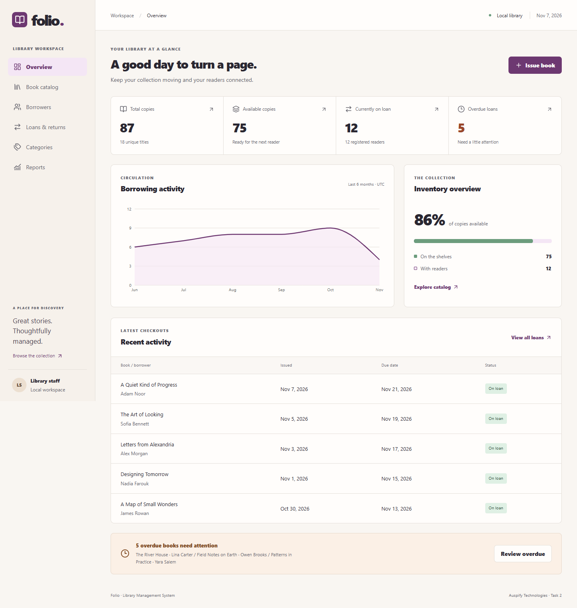
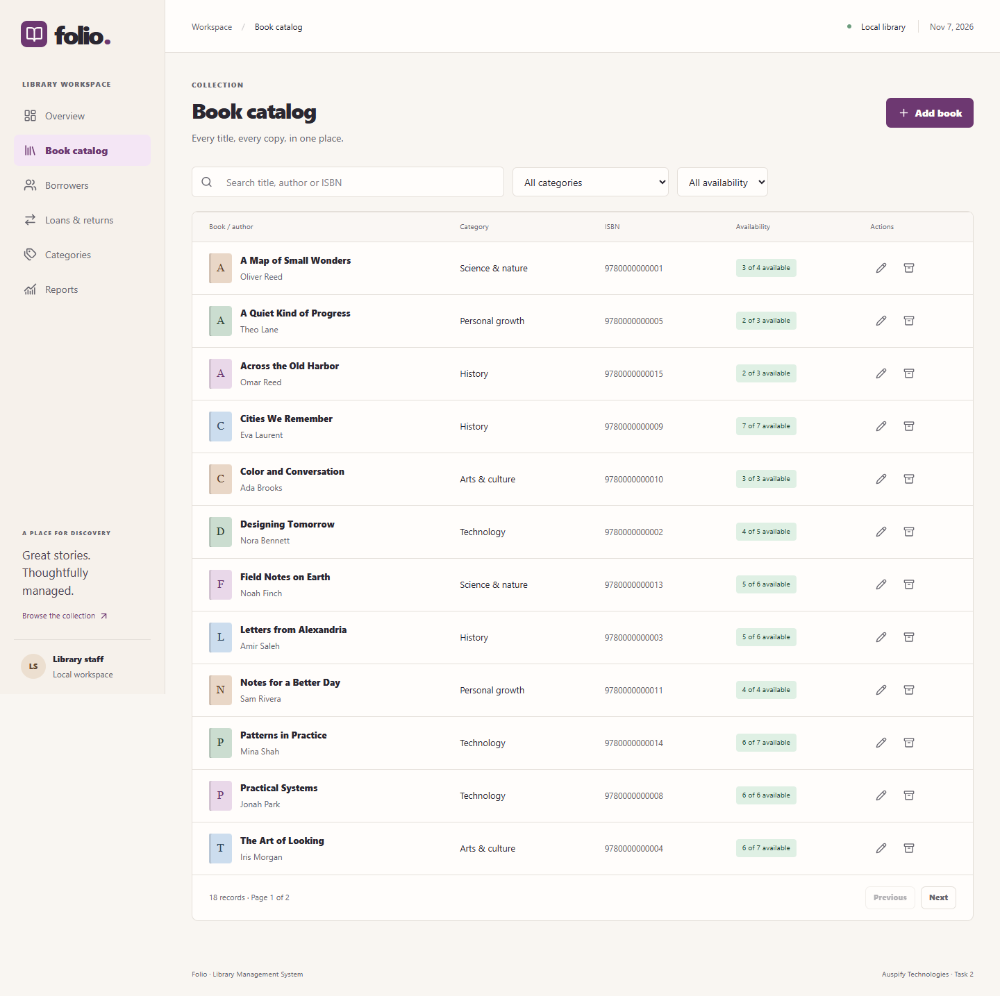
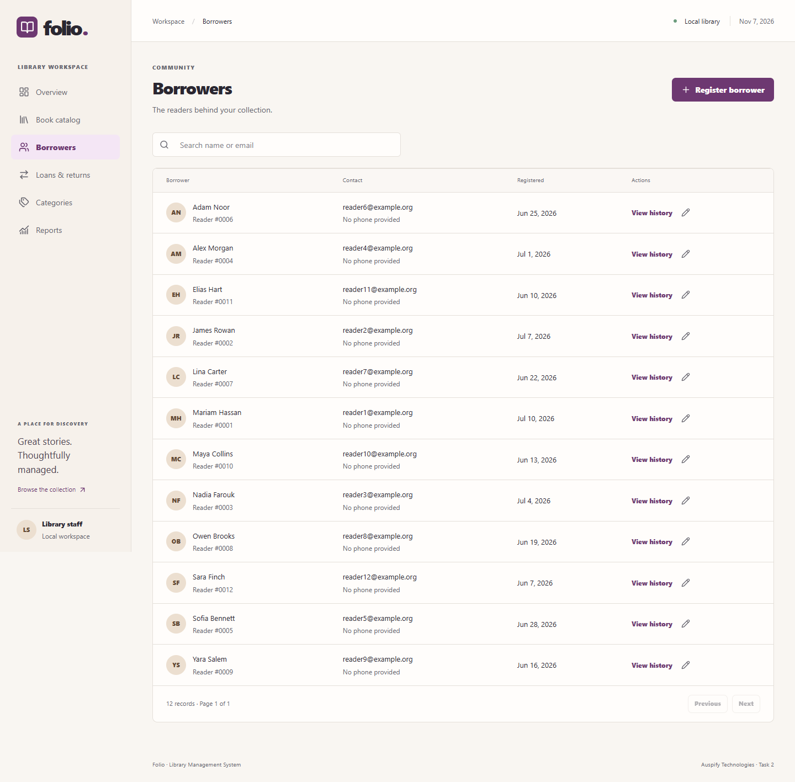
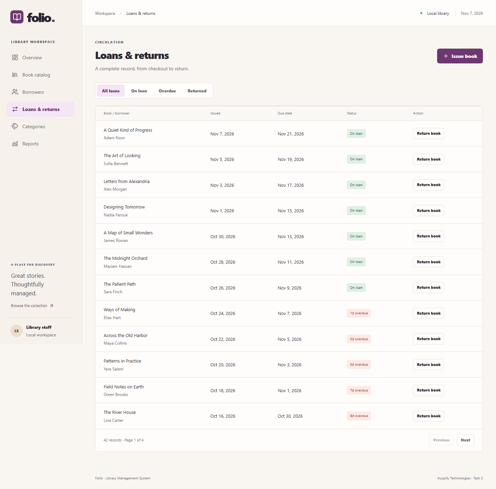
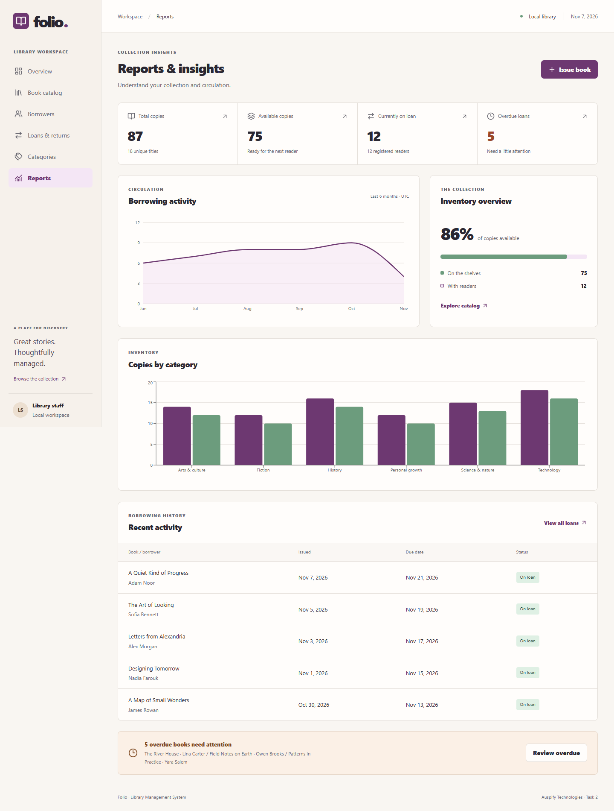

# Folio · Library Management System

A complete library staff workspace built for **Auspify Technologies, Internship Task 2**. Manage a collection, register readers, issue books, process returns and understand circulation through a responsive dashboard.

[Repository](https://github.com/Jaclyn25/library-management-system) · [Validation workflow](https://github.com/Jaclyn25/library-management-system/actions/workflows/ci.yml) · [API guide](docs/api.md) · [Submission package](submission/PROJECT-SUMMARY.md)



## Features

- **Collection:** add, edit and view books; manage categories; search titles, authors and ISBNs; filter by category and availability; paginate results; archive safely.
- **Readers:** register and edit borrowers, search contact details and inspect complete borrowing history.
- **Circulation:** issue available copies, choose UTC due dates, reject duplicate checkouts and unavailable titles, return exactly once and preserve late-return history.
- **Reporting:** total and available copies, active and overdue loans, title and borrower totals, category breakdown, six-month borrowing activity and recent checkouts.
- **Staff experience:** responsive navigation, readable tables, validated forms, native accessible dialogs, loading skeletons, empty states, error feedback and success notifications.
- **Reliability:** PostgreSQL transactions, atomic conditional stock updates, unique and check constraints, reproducible EF migrations, structured JSON logging and consistent API problems.

## Screenshots

These are actual browser captures of the running application using fictional seed records. They are not mockups.

| Catalog | Borrowers |
| --- | --- |
|  |  |

| Circulation | Reporting |
| --- | --- |
|  |  |

[Checkout screen](docs/screenshots/checkout.png) · [Mobile dashboard](docs/screenshots/mobile.png)

## Technology stack

| Layer | Technologies |
| --- | --- |
| API | ASP.NET Core 10, C#, EF Core 10, Npgsql, Data Annotations plus service validation, OpenAPI, JSON console logging |
| Database | PostgreSQL 17 |
| Client | React 19, TypeScript 5.9, Vite 8, Tailwind CSS 4, React Router 7 |
| State and forms | TanStack Query 5, React Hook Form 7, Zod 4 |
| Charts | Recharts 3 |
| Tests | xUnit, ASP.NET Core WebApplicationFactory, Vitest 5, React Testing Library, Playwright |
| Delivery | Docker Compose, Nginx, GitHub Actions; no automatic deployment |

Exact JavaScript versions are recorded in `frontend/package-lock.json`; .NET package versions are in the project files. Native development requires **.NET SDK 10** and **Node 22.22+ or Node 24 LTS**. The Docker frontend build uses Node 22 LTS.

## Architecture

```text
React workspace
    │ same-origin /api requests
    ▼
Vite proxy (development) / Nginx (Compose)
    ▼
Thin ASP.NET Core controllers
    ▼
Scoped catalog, borrower, circulation and report services
    ▼
EF Core DbContext + PostgreSQL
```

Controllers handle HTTP routing and DTO validation. Services own business rules. The DbContext defines persistence and explicit constraints. No unnecessary repository or messaging layer is introduced.

Issuing decrements availability with a conditional database UPDATE inside a transaction. PostgreSQL locks the book row and rechecks availability after competing updates. Unique operation IDs and active borrower/title indexes reject duplicate work; failed inserts roll back stock changes. Returns update only unreturned loans and restore stock in the same transaction. Stock edits use arithmetic against the current database row. Reports use a repeatable-read transaction so totals share a consistent snapshot.

[Architecture notes](docs/architecture.md) · [Design principles](PRODUCT.md) · [Visual system](DESIGN.md)

## Repository layout

```text
backend/Library.Api/       API, contracts, services, data, migrations
frontend/src/             React pages, shared UI and interaction tests
frontend/e2e/             Playwright critical flows
tests/Library.Tests/      Real PostgreSQL API and business tests
docs/                     Architecture, API, testing and screenshots
scripts/                  Local configuration, API startup and tests
.github/workflows/        Build, test, lint and browser validation
submission/               Reviewer summary, setup, screenshots and results
```

## Quick start with Docker

Install Docker Desktop with Linux containers and start the engine. Clone this existing repository using an account with access.

```powershell
git clone https://github.com/Jaclyn25/library-management-system.git
cd library-management-system
pwsh ./scripts/init-env.ps1
docker compose up --build -d
docker compose ps
```

Open **[http://localhost:8080](http://localhost:8080)**. Initial package and image downloads can take several minutes. Compose starts PostgreSQL, applies migrations, optionally seeds an empty database and serves React through Nginx. Health checks order service startup. The API runs as a non-root container user.

On Linux/macOS without PowerShell, copy `.env.example` to `.env` and set `POSTGRES_PASSWORD` to a strong random value before starting Compose. Never commit `.env`.

```sh
cp .env.example .env
# Edit .env and set POSTGRES_PASSWORD, then:
docker compose up --build -d
```

`docker compose stop` stops services while preserving data. `docker compose down` removes containers and preserves the named database volume. Do not remove the volume unless you intentionally want to erase the local database.

## Environment configuration

| Variable | Meaning |
| --- | --- |
| `POSTGRES_DB` | Local database name, default example `library` |
| `POSTGRES_USER` | Local database user, default example `library` |
| `POSTGRES_PASSWORD` | Required local secret; generated by `init-env.ps1` |
| `LIBRARY_SEED` | Compose seed toggle, defaults to `true`; use `false` for an empty catalog |
| `LIBRARY_WEB_PORT` | Optional loopback web port, default `8080`; set `18080` when Windows reserves 8080 |
| `ConnectionStrings__Library` | Explicit native API connection string; takes precedence over individual database variables |
| `Database__Host`, `Database__Port` | API connection host and port when using separate PostgreSQL variables |
| `Database__Migrate` | Apply migrations at startup when `true` |
| `Database__Seed` | Seed an empty database after migration when `true` |
| `LIBRARY_TEST_CONNECTION` | PostgreSQL admin connection for disposable integration test databases |
| `PLAYWRIGHT_CHANNEL` | Optional installed browser channel, such as `msedge` on Windows |

Compose binds web port **8080** and PostgreSQL port **54329** to loopback only. The API is internal to the Compose network. The database uses the named `library-data` volume. Native Vite uses **5173** and the API uses **5080**.

If port 8080 is unavailable, add `LIBRARY_WEB_PORT=18080` to `.env`, rerun `docker compose up -d`, and open **[http://127.0.0.1:18080](http://127.0.0.1:18080)**. This is the port verified in the Windows development environment.

## Native development

Start PostgreSQL, restore dependencies and launch the API:

```powershell
pwsh ./scripts/init-env.ps1
docker compose up -d db
dotnet tool restore
dotnet restore
pwsh ./scripts/start-api.ps1
```

In another terminal:

```sh
cd frontend
npm ci
npm run dev
```

Open **[http://localhost:5173](http://localhost:5173)**. The API startup script reads the ignored `.env`, configures the local connection, applies migrations and enables fictional seeding. Seeding only runs when books, borrowers and categories are all empty. Initial data contains 18 fictional titles, 12 borrowers and 42 historical/current loans.

For another operating system, provide `ConnectionStrings__Library`, `Database__Migrate=true`, `Database__Seed=true`, and `ASPNETCORE_ENVIRONMENT=Development` in your shell, then run:

```sh
dotnet run --project backend/Library.Api --no-launch-profile --urls http://localhost:5080
```

To add a migration:

```sh
dotnet tool restore
dotnet ef migrations add YourChange --project backend/Library.Api
```

To apply migrations separately, set `ConnectionStrings__Library` and run `dotnet ef database update --project backend/Library.Api`. Existing migrations are also applied by the documented startup paths. Database credentials stay in local environment configuration.

## API documentation

Development OpenAPI: **[/openapi/v1.json](http://localhost:5080/openapi/v1.json)** for the native API, or **[Compose OpenAPI](http://localhost:8080/openapi/v1.json)**. Import the schema into an OpenAPI client such as Swagger Editor or Postman.

The [API guide](docs/api.md) documents endpoints, JSON payloads, pagination, validation and error semantics. Main resources are `/api/books`, `/api/categories`, `/api/borrowers`, `/api/loans` and `/api/reports`.

## Testing and verification

With PostgreSQL running:

```powershell
pwsh ./scripts/test.ps1 --configuration Release
```

For Linux/macOS, set `LIBRARY_TEST_CONNECTION` to a PostgreSQL connection with CREATEDB permission and run `dotnet test --configuration Release`. Each fixture creates a unique database, applies every migration and drops it afterward. Tests use the real PostgreSQL provider.

```sh
cd frontend
npm ci
npm run build
npx tsc --noEmit
npm run lint
npm test
npm audit
```

With the native API running, Playwright starts Vite if needed:

```sh
npx playwright install chromium
npm run test:e2e
```

On Windows, an installed Edge browser can be used by setting `$env:PLAYWRIGHT_CHANNEL='msedge'` in PowerShell. Local browser tests create fictional QA records in the development database. CI uses a dedicated disposable database.

To test the built Docker app, set `E2E_BASE_URL` to its URL before running `npm run test:e2e`. For example, `$env:E2E_BASE_URL='http://127.0.0.1:18080'` in PowerShell. Playwright then uses that app instead of starting Vite.

**Verified:** 19 backend tests, 6 frontend interaction tests and 2 browser flows pass. Both production builds, TypeScript checks and lint pass. The frontend dependency audit reports zero vulnerabilities. See [actual results](submission/TEST-RESULTS.md) and [testing details](docs/testing.md).

## Git workflow and CI

Implementation was delivered through separate feature pull requests into `main`, with Conventional Commits and validation before merge. The empty existing remote required an empty baseline commit before PR creation. No new repository was created, visibility was preserved and `main` was never force-pushed.

GitHub Actions runs .NET build and PostgreSQL-backed tests, TypeScript checking, frontend build, lint, frontend tests and real Chromium flows. Failure artifacts retain browser reports, screenshots, traces and API logs. There is no deployment job. The repository's GitGuardian integration also scans each PR.

CI uses Ubuntu 24.04 and explicitly pinned releases of GitHub's checkout, setup and artifact actions that support the Node 24 action runtime.

The [delivery record](submission/DELIVERY.md) lists branches and pull requests.

## Known limitations

- Intended for a trusted local staff environment. Authentication, authorization and public-hosting hardening are not included. Keep it on loopback until those are implemented.
- ISBN format and uniqueness are validated; ISBN check digits are not enforced.
- A borrower can have one active copy of a given title. Duplicate operations return a conflict rather than replaying a prior success response.
- Due dates and calculations use UTC. The checkout form uses the end of the selected UTC day. Late days round up elapsed partial days; there are no fines or notification emails.
- Archive preserves book and loan history. There is no restore screen or permanent book deletion.
- Search uses PostgreSQL substring matching, suitable for this project size. Large catalogs would benefit from indexed full-text search. Category lists are unpaginated; checkout search shows up to 100 matches at a time.
- No public deployment, internship portal submission, or demo video is included.

## Submission

The [submission directory](submission/PROJECT-SUMMARY.md) contains the project summary, feature checklist, source and repository references, setup instructions, actual screenshots, test evidence, delivery record and optional demo recording instructions. Nothing is submitted automatically.
